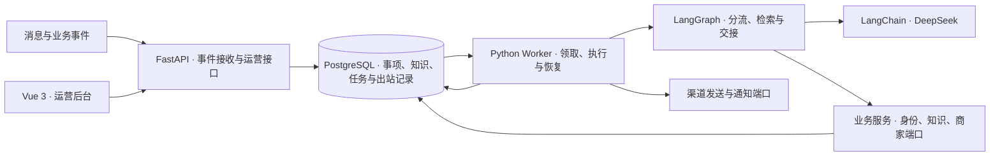

# 私域运营助手 · Member Ops Agent

为小型自营运动品牌设计的社群 Agent 与运营后台。典型场景是一位运营负责两个会员群。助手处理商品咨询、导购、订单与活动查询，运营在后台接手例外、维护资料、管理会员记忆并确认触达。

仓库提供独立运行的源码、运营后台和虚构业务样例。DeepSeek Flash 已通过官方 API 联调，微信、商家和邮件链路通过测试适配器验收。会员侧通过规范消息事件接入，运营侧使用 Vue 后台。

## 能做什么

| 场景 | 业务行为 |
| --- | --- |
| 社群答疑与导购 | 处理明确呼叫或有效引用。按商品和知识版本回答，导购可结合用途、预算、尺码和库存 |
| 本人订单与权益 | 核验会员身份、会话范围及订单归属。订单、物流和个人资格只在符合授权的私密会话返回 |
| 会员经营 | 记录明确偏好及其来源，支持更正、删除、候选标签审核和人群预览。临时条件保留在当前事项 |
| 活动与触达 | 支持报名、打卡、问卷、补货订阅、新人欢迎和购后关怀。定向计划由运营确认，发送前复查资格 |
| 转人工与复盘 | 投诉、明确人工请求等进入同一运营待办。群复盘可定位原始依据，知识发布后可用原问题验证 |

## 系统架构

1. **接收和分流**。FastAPI 保存事件、规范消息和处理任务。Worker 定位同一渠道、会话及会员的候选事项，规则与 DeepSeek 共同完成意图分流。
2. **按需组织上下文**。公开引用、当前事项与长期偏好分开。RAG 从 PostgreSQL 检索有效知识版本，再让模型基于命中的资料作答。订单、库存和权益由相应业务源提供。
3. **提交与交付**。业务结果、证据和出站记录一起提交。Worker 发送前复查绑定、订阅、活动及暂停状态。无法确认发送结果时，等待回执或运营核实。

## 从哪里读代码

| 入口 | 对应实现 |
| --- | --- |
| [backend/app/main.py](backend/app/main.py) · [ingress.py](backend/app/ingress.py) | API 装配、入站规范化及持久接收 |
| [agent.py](backend/app/agent.py) · [conversation.py](backend/app/conversation.py) | 意图图、知识检索与生成、事项范围及人工交接 |
| [commerce.py](backend/app/commerce.py) · [merchant.py](backend/app/merchant.py) · [members.py](backend/app/members.py) | 商家适配器、业务查询、会员记忆和授权 |
| [worker.py](backend/app/worker.py) · [outreach.py](backend/app/outreach.py) · [delivery.py](backend/app/delivery.py) | PostgreSQL 队列、触达复核、结果回填及恢复 |
| [frontend/src](frontend/src) · [backend/migrations](backend/migrations) · [backend/tests](backend/tests) | 运营界面、Alembic 数据迁移和业务集成验收 |

## 运行与文档

本机运行使用 Python 3.14、PostgreSQL 18 和 Node.js 24。按运行手册初始化专用数据库、启动 API 与 Worker，再打开 [本机运营后台](http://127.0.0.1:5173/)。手册附有可直接提交的测试消息、会员绑定和运营触达示例。

| 文档 | 内容 |
| --- | --- |
| [本机运行与演示](docs/RUNBOOK.md) | 安装、配置、启动、样例及测试命令 |
| [产品基线](docs/PRODUCT_BASELINE.md) | 产品范围、角色、业务流、记忆规则和验收条件 |
| [技术基线](docs/TECHNICAL_BASELINE.md) | Agent 节点、上下文边界、事务、并发和故障恢复 |
| [API 与事件契约](docs/API_CONTRACT.md) | 运营 HTTP、入站事件、外部适配器和错误语义 |
| [实施计划与 SPEC](docs/IMPLEMENTATION_PLAN.md) | WP01–WP04 功能拆分及各工作包的实现范围 |
| [部署说明](docs/DEPLOYMENT.md) · [发布验收记录](docs/RELEASE_ACCEPTANCE.md) | Linux 部署、健康检查、功能回归、浏览器与真实模型验证 |

WP01–WP04 的 4 个业务集成场景在本机和独立服务器测试库通过。前端构建、部署接口检查与后台浏览器走查均已完成。详见 [发布验收记录](docs/RELEASE_ACCEPTANCE.md)。
